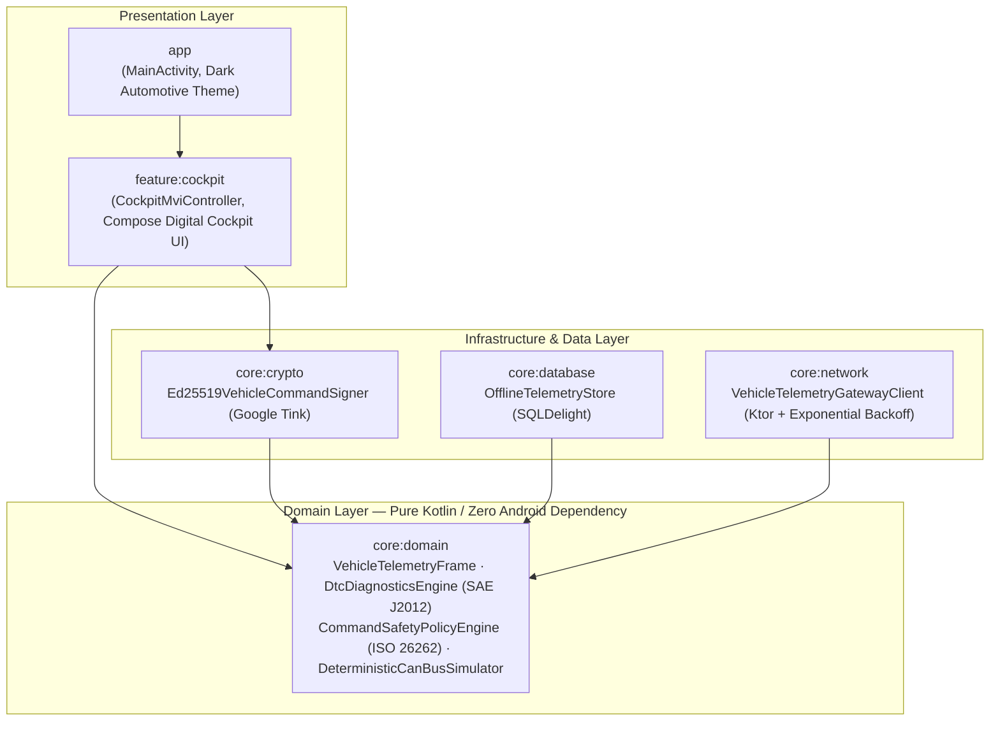

# Connected Vehicle Telemetry & Remote Actuation Android SDK

**Production-grade, multi-module Android SDK and Jetpack Compose Digital Cockpit for Connected Car / e-Mobility ecosystems — featuring ISO 26262 (ASIL-B) inspired safety interlocks, Ed25519 cryptographic command signing, SAE J2012 OBD-II / CAN-Bus diagnostic fault evaluation, and SQLDelight offline-first telemetry persistence.**

Built to address the core architectural challenges of modern automotive telematics platforms (e.g., *Connected Vehicle Companion Apps, Telematics Control Unit [TCU] Gateways, and Fleet Mobility Suites*):
1. **Zero-Trust Remote Actuation:** How do you guarantee that a remote door-unlock, trunk-release, or HVAC pre-conditioning request originates from an authorized owner device and has not been replayed or tampered with in transit?
2. **Functional Safety Interlocks (ISO 26262):** How do you prevent dangerous remote actuations when the vehicle is in motion (`speed > 0.5 km/h` or transmission not in `PARK`) or prevent battery depletion when high-voltage SoC is below critical thresholds?
3. **Tunnel / Dead-Zone Resilience:** How do you maintain deterministic telemetry state and queue signed remote commands when the vehicle or mobile device enters underground parking or cellular dead-zones?

---

## System Architecture

Clean Architecture across 6 Gradle modules with strict inward dependency direction (`:core:domain` is pure Kotlin with zero Android platform dependencies):



---

## Key Engineering Pillars

### 1. ISO 26262 Inspired Remote Actuation Safety Interlocks (`CommandSafetyPolicyEngine`)
Every remote command (`UNLOCK_DOORS`, `OPEN_TRUNK`, `START_HVAC_PRECONDITIONING`, `START_CHARGE_LIMIT_80`) is evaluated against live vehicle telemetry before signing:
- **Motion & Transmission Interlock:** Rejects `UNLOCK_DOORS` and `OPEN_TRUNK` if `speedKmh > 0.5` (`VEHICLE_IN_MOTION`) or `gearPosition != GearPosition.PARK` (`GEAR_NOT_IN_PARK`).
- **HV Battery Depletion Guard:** Rejects remote cabin pre-conditioning (`START_HVAC_PRECONDITIONING`) when high-voltage battery State of Charge (SoC) is below `15.0%` (`BATTERY_SOC_TOO_LOW`) or target temperature is outside `[16.0°C, 28.0°C]`.
- **Anti-Replay & TTL Window Enforcement:** Enforces strict command expiration (`maxCommandTtlMs = 60,000ms`), clock-skew tolerance (`5,000ms`), and an LRU nonce registry (`REPLAY_NONCE_DETECTED`).

### 2. Asymmetric Ed25519 Command Signing (`Ed25519VehicleCommandSigner`)
- Powered by **Google Tink** (`ED25519`).
- Constructs a canonical deterministic payload (`v1|<commandId>|<vin>|<actuationType>|<targetTemp>|<issuedAt>|<expiresAt>|<nonceHex>`) and attaches a Base64-encoded Ed25519 signature (`X-TCU-Signature-Ed25519`) alongside the `Idempotency-Key` HTTP header.
- Any modification to the VIN, actuation type, or timestamp invalidates the signature immediately.

### 3. SAE J2012 / ISO 15031-6 OBD-II & EV Diagnostics (`DtcDiagnosticsEngine`)
- Parses 5-character diagnostic trouble codes across all four automotive subsystems:
  - **`Pxxxx` (Powertrain & HV Inverter):** e.g., `P0A80` (*HV Battery Pack Deterioration*), `P0AA6` (*HV Isolation Fault*), `P0300`, `P0420`.
  - **`Cxxxx` (Chassis / ABS / ESC):** e.g., `C0035` (*Wheel Speed Sensor Supply Circuit*).
  - **`Bxxxx` (Body / HVAC / Immobilizer):** e.g., `B1200` (*Climate Control Actuator Circuit*).
  - **`Uxxxx` (CAN-Bus / UART Network):** e.g., `U0100` (*Lost Communication With ECM/PCM*).
- Computes a real-time **0–100 Vehicle Health Score** combining active DTC severities, high-voltage battery thermal spikes (`>= 50.0°C`), low tire pressure (`< 1.9 bar`), and low SoC alerts.

### 4. Offline-First SQLDelight Persistence & Ktor Gateway (`:core:database`, `:core:network`)
- **SQLDelight (`OfflineTelemetryStore`):** Compiled, type-safe SQL tables (`telemetry_frame_entity`, `pending_command_entity`) persisting the latest vehicle telemetry frames and queuing signed command envelopes during offline periods.
- **Ktor (`VehicleTelemetryGatewayClient`):** Configured with automatic `HttpRequestRetry` exponential backoff for `5xx` / `429` cellular gateway transients and deterministic `Idempotency-Key` headers.

---

## Module Structure

```text
├── app/                  Android host application & dark automotive theme
├── core/
│   ├── domain/           Pure Kotlin models, SAE J2012 DTC parser, ISO 26262 safety policy, CAN-Bus simulator
│   ├── crypto/           Google Tink Ed25519 command signer & signature verifier
│   ├── database/         SQLDelight schema & offline telemetry/command queue store
│   └── network/          Ktor TCU Cloud Gateway client with idempotency & retry policies
├── feature/
│   └── cockpit/          Jetpack Compose Digital Cockpit UI & unidirectional MVI controller
└── docs/
    └── adr/              Architecture Decision Records (ADR-001 through ADR-003)
```

---

## Running Tests & Verification

All domain, cryptographic, network, database, and MVI controller layers are covered by fast, deterministic JVM unit tests (no emulator required):

```bash
# Run all unit tests across all modules
./gradlew test --console=plain

# Run pure-JVM domain, crypto, and network test suites
./gradlew :core:domain:test :core:crypto:test :core:network:test

# Assemble debug APK
./gradlew :app:assembleDebug
```

---

## Tech Stack

- **Language & Concurrency:** Kotlin 2.1, Coroutines, StateFlow
- **UI Framework:** Jetpack Compose (Material 3), `@Immutable` MVI State Architecture
- **Cryptography:** Google Tink (`Ed25519` asymmetric signing & verification)
- **Persistence:** SQLDelight 2.3 (Typed SQL + JDBC In-Memory JVM test driver)
- **Networking:** Ktor Client (CIO Engine, WebSockets, `HttpRequestRetry`, `kotlinx.serialization`)
- **Testing & Quality:** JUnit 4, `kotlinx-coroutines-test`, Ktor `MockEngine`, SQLDelight `JdbcSqliteDriver`

---

## License
MIT License. See [LICENSE](LICENSE).
